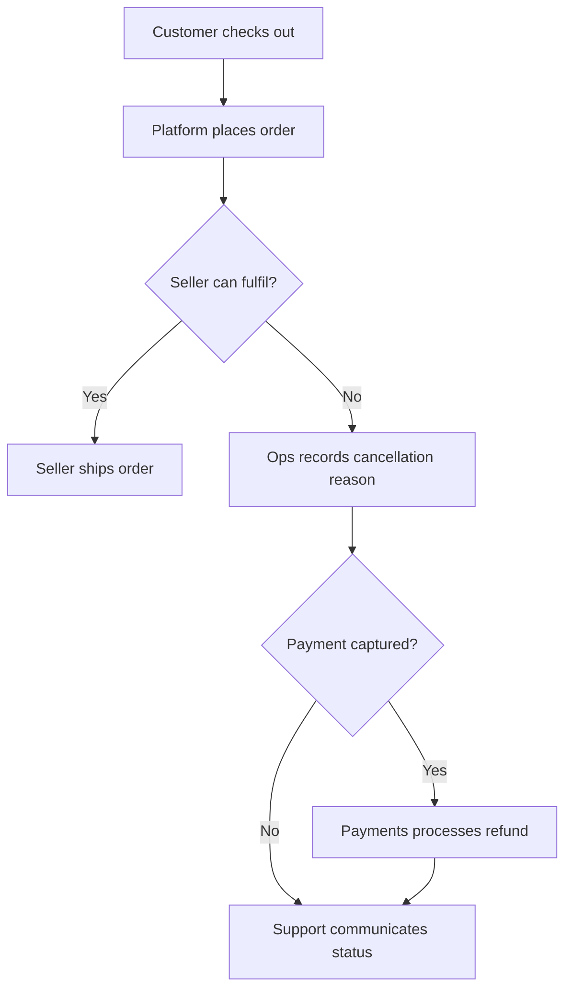
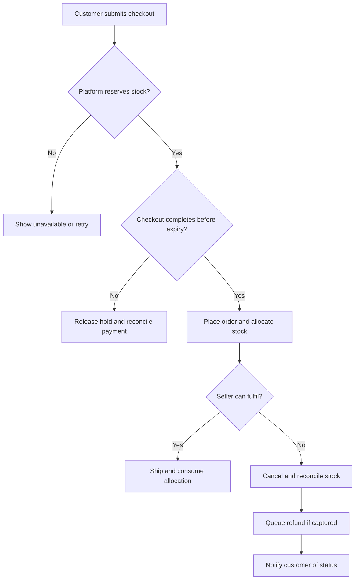

# 03 · Current and proposed process

## AS-IS hypothesis

## TO-BE proposal

| Handoff | Current gap | Proposed control |
|---|---|---|
| Listing to checkout | Display may lag stock | Check authoritative availability when reserving |
| Checkout to payment | Final unit can be promised twice | Atomic hold keyed to checkout attempt |
| Payment to order | Callback may arrive after expiry | Reconcile late payment and prevent order resurrection |
| Seller to operations | Reason can be unclear | Require reason and isolate suspected missing inventory |
| Operations to support | Refund state can be unclear | Separate cancellation and refund statuses |
