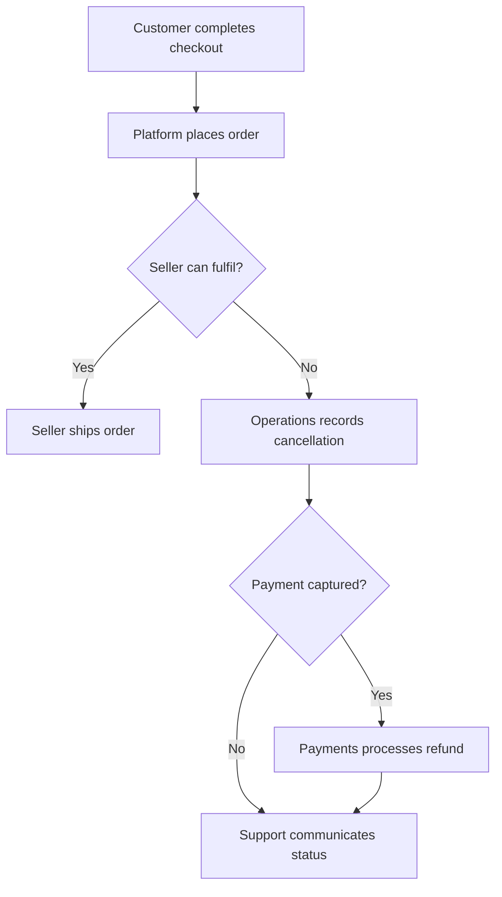
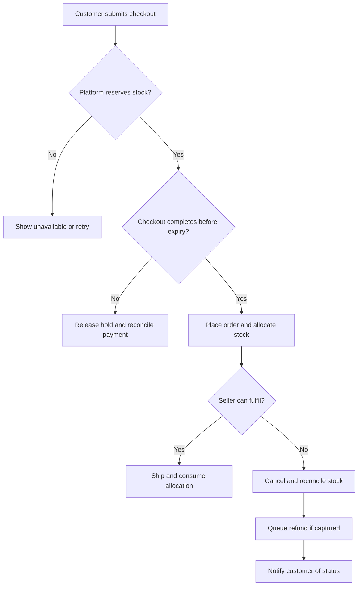

# E-Commerce Order Cancellation Analysis and Process Improvement

### Business Analyst Portfolio Project

An end-to-end Business Analyst case study exploring stock-related order cancellations in an e-commerce marketplace.

This project combines SQL analysis, root-cause investigation, process mapping, requirements documentation, user stories, and UAT planning to propose improvements to inventory availability and order fulfilment.

> **Project context:** This is a portfolio case study using 1,000 synthetic orders. The proposed solution, targets, financial assumptions, and rollout plan are illustrative. Business acceptance testing and implementation are planned activities.

---

## Table of Contents

- [Project Overview](#project-overview)
- [Business Problem](#business-problem)
- [Business Objectives](#business-objectives)
- [Scope and Assumptions](#scope-and-assumptions)
- [Stakeholders](#stakeholders)
- [Business Analyst Responsibilities](#business-analyst-responsibilities)
- [Dataset Overview](#dataset-overview)
- [Analysis Dashboard](#analysis-dashboard)
- [Key Findings](#key-findings)
- [Root-Cause Analysis](#root-cause-analysis)
- [Current Process](#current-process)
- [Proposed Process](#proposed-process)
- [Solution Offerings](#solution-offerings)
- [Business Requirements](#business-requirements)
- [Functional Requirements](#functional-requirements)
- [Non-Functional Requirements](#non-functional-requirements)
- [User Stories and Prioritization](#user-stories-and-prioritization)
- [Acceptance Criteria](#acceptance-criteria)
- [UAT and Traceability](#uat-and-traceability)
- [Business Case](#business-case)
- [Implementation and Rollout Plan](#implementation-and-rollout-plan)
- [Success Metrics](#success-metrics)
- [Risks and Dependencies](#risks-and-dependencies)
- [Tools and Techniques](#tools-and-techniques)
- [Repository Structure](#repository-structure)
- [How to Run the Analysis](#how-to-run-the-analysis)
- [Project Deliverables](#project-deliverables)
- [Limitations and Future Enhancements](#limitations-and-future-enhancements)
- [Skills Demonstrated](#skills-demonstrated)

---

## Project Overview

An e-commerce marketplace depends on sellers to maintain accurate inventory and fulfil accepted orders.

When displayed availability differs from actual stock, customers can place orders that sellers cannot fulfil. The resulting cancellations create customer dissatisfaction, additional support work, payment reconciliation tasks, and lost sales opportunities.

This project examines cancellation patterns and proposes a checkout stock reservation workflow supported by seller inventory reconciliation, consistent cancellation reasons, and operational exception monitoring.

| Project attribute | Details |
|---|---|
| Domain | E-commerce marketplace |
| Primary focus | Stock-related order cancellations |
| Project type | Business Analyst portfolio case study |
| Dataset | 1,000 synthetic placed orders |
| Analysis period | Four illustrative weekly cohorts |
| Proposed solution | Checkout stock reservation and exception reconciliation |
| Delivery status | Analysis and proposed design completed |
| Implementation status | Proposed |
| UAT status | Planned |

---

## Business Problem

The marketplace can accept an order even when the seller cannot supply the product.

This may happen when inventory updates are delayed, two customers attempt to purchase the last available unit, or physical stock differs from the seller’s recorded quantity.

The issue may only become visible during seller confirmation or picking, after the customer has already completed checkout.

### Customer Impact

- Customers spend time ordering products that cannot be fulfilled.
- Prepaid customers may need to wait for a refund.
- Customers need clear communication about cancellation and refund status.

### Seller Impact

- Sellers spend time reviewing and rejecting unfulfillable orders.
- Repeated inventory discrepancies create operational exceptions.
- Sellers need a reliable way to update and reconcile stock.

### Operations and Support Impact

- Teams investigate cancellations and respond to complaints.
- Inconsistent cancellation reasons make reporting difficult.
- Payment and refund exceptions require follow-up.

### Business Impact

- Accepted orders fail to convert into completed sales.
- Support and reconciliation work increases.
- The marketplace needs evidence to decide which controls to prioritize.

---

## Business Objectives

| Objective | Proposed outcome | Measurement |
|---|---|---|
| Reduce stock-related cancellations | Pilot target of 4.0% or lower | Stock cancellations ÷ placed orders |
| Prevent concurrent overselling | Only one checkout can claim the final available unit | Concurrency and retry tests |
| Improve cancellation visibility | Every cancelled order has a reason, actor, stage, and timestamp | Cancellation record completeness |
| Improve failure recovery | Expired holds and failed checkouts release inventory consistently | Hold reconciliation checks |
| Improve refund handling | Eligible prepaid cancellations generate one refund handoff | Refund reconciliation and duplicate checks |
| Protect the customer journey | Monitor whether reservation controls affect valid checkout completion | Checkout conversion and exception rates |

The 4.0% target is an illustrative pilot goal. A production baseline and feasibility review would be required before committing to it.

---

## Scope and Assumptions

### In Scope

- Single-item, single-seller orders.
- One fulfilment location per seller SKU.
- Order cancellation analysis.
- Checkout stock availability checks and reservation.
- Reservation expiry and release.
- Conversion of reservations into order allocations.
- Seller stock discrepancy handling.
- Cancellation reason capture.
- Refund handoff and exception visibility.
- Business requirements, user stories, and UAT planning.

### Out of Scope

- Multi-seller carts.
- Partial order cancellations.
- Product substitutions.
- Warehouse redesign.
- Payment provider replacement.
- Automated replenishment.
- Implementation of fixes for every cancellation category.

### Key Assumptions

- Sellers maintain inventory records for their products.
- Inventory and payment events can arrive late or be duplicated.
- The platform can access an authoritative inventory write path.
- Physical stock accuracy still depends on seller processes.
- All data, stakeholder roles, and financial values in this case study are illustrative.

---

## Stakeholders

| Stakeholder | Main interest | Expected contribution |
|---|---|---|
| Product Manager | Business value and customer experience | Approve scope, priorities, and rollout gates |
| Sellers | Accurate stock and manageable fulfilment | Explain inventory updates and stock discrepancies |
| Marketplace Operations | Reliable order processing | Validate workflows and own exception handling |
| Engineering | Consistent inventory and payment behavior | Assess feasibility and design system controls |
| Customer Support | Clear customer communication | Review cancellation reasons and refund visibility |
| Payments Team | Payment and refund reconciliation | Validate late captures and refund handling |
| QA | Testable requirements | Validate acceptance criteria and execute tests |
| Customers | Successful orders and clear status | Inform customer journey requirements |

---

## Business Analyst Responsibilities

The case study demonstrates the following BA activities.

- Define the business problem, objectives, scope, and assumptions.
- Identify stakeholders and prepare discovery questions.
- Analyze cancellation patterns using SQL.
- Document potential root causes and evidence needed to validate them.
- Map the current and proposed processes.
- Translate business needs into business and functional requirements.
- Define inventory and cancellation business rules.
- Prioritize user stories using MoSCoW.
- Write acceptance criteria and UAT scenarios.
- Link requirements to validation through a traceability matrix.
- Compare solution options and prepare an illustrative business case.
- Define rollout gates, risks, dependencies, and success metrics.

Stakeholder interviews and production validation are proposed discovery activities.

---

## Dataset Overview

The dataset contains **1,000 synthetic placed orders**, with one record per order.

Each of the four weekly cohorts contains 250 orders. Every order has a final outcome in the demo.

| Field | Description |
|---|---|
| `order_id` | Unique synthetic order reference |
| `placed_date` | Date the order was placed |
| `cohort_week` | Weekly placement cohort |
| `seller_id` | Synthetic seller reference |
| `category` | Product category |
| `payment_method` | PREPAID or COD |
| `order_value_inr` | Synthetic order value |
| `status` | COMPLETED or CANCELLED |
| `cancellation_reason` | Primary cancellation reason |
| `detection_stage` | Stage where the issue surfaced |
| `stock_driver` | Simulated driver for stock cancellations |

### Data Quality Checks

- Order IDs must be unique.
- Cancelled orders must contain a cancellation reason and detection stage.
- Completed orders must have empty cancellation fields.
- Stock driver labels must appear only on stock-related cancellations.

---

## Analysis Dashboard

The dashboard summarizes cancellation rates, primary reasons, detection stages, stock-related drivers, and weekly stock cancellation rates.

### Dashboard Metrics

| Metric | Calculation | Demo result |
|---|---|---:|
| Placed orders | Count of unique orders | 1,000 |
| Cancelled orders | Count of cancelled orders | 120 |
| Completed orders | Placed orders − cancelled orders | 880 |
| Overall cancellation rate | 120 ÷ 1,000 × 100 | 12.0% |
| Stock-related cancellations | Count with reason “Stock unavailable” | 60 |
| Stock cancellation rate | 60 ÷ 1,000 × 100 | 6.0% |
| Stock share of cancellations | 60 ÷ 120 × 100 | 50.0% |

The dashboard values are generated from the included synthetic dataset.

---

## Key Findings

### Cancellation Reasons

| Primary reason | Cancelled orders | Share of cancellations |
|---|---:|---:|
| Stock unavailable | 60 | 50.0% |
| Customer request | 20 | 16.7% |
| Payment exception | 15 | 12.5% |
| Delivery exception | 10 | 8.3% |
| Seller processing | 8 | 6.7% |
| Platform error | 5 | 4.2% |
| Unknown | 2 | 1.7% |
| **Total** | **120** | **100%** |

Displayed percentages are rounded and may not sum exactly to 100%.

### Detection Stages

| Stage where the issue surfaced | Cancelled orders |
|---|---:|
| Seller confirmation | 58 |
| Pre-dispatch | 32 |
| Payment reconciliation | 20 |
| Picking | 10 |
| **Total** | **120** |

### Stock-Related Drivers

| Simulated driver | Stock cancellations | Share of stock cancellations |
|---|---:|---:|
| Stale stock | 30 | 50.0% |
| Concurrent oversell | 20 | 33.3% |
| Physical mismatch | 10 | 16.7% |
| **Total** | **60** | **100%** |

### Business Interpretation

Stock availability is the largest cancellation category in this fixture.

The proposed solution addresses concurrent overselling through checkout reservation. Stale stock and physical mismatch also require reliable seller updates and inventory reconciliation.

The dataset contains 20 simulated concurrent oversell cases. Preventing all 20 while holding other outcomes and the denominator constant would reduce stock cancellations from 60 to 40, equivalent to 4.0% of 1,000 placed orders. This is a scenario to validate in a pilot.

---

## Root-Cause Analysis

### Potential Causes and Validation

| Area | Potential contributor | Evidence to investigate |
|---|---|---|
| People | Offline sales are not entered promptly | Seller interviews and offline sales records |
| Process | Inventory is checked after order placement | Order and seller confirmation timestamps |
| Systems | Multiple checkouts claim the same available unit | Reservation logs and concurrency tests |
| Data | Physical stock differs from system stock | Physical counts and inventory ledger |
| Policy | Seller confirmation deadlines lack escalation | SLA records and alert history |
| External partners | Payment or delivery events arrive late | Provider and internal event timestamps |

### 5 Whys Example

| Step | Question | Hypothesis |
|---|---|---|
| 1 | Why did the order cancel? | The seller could fulfil only one of two accepted orders. |
| 2 | Why were two orders accepted? | Both checkouts saw one available unit. |
| 3 | Why did both see the same unit? | Both availability reads occurred before allocation. |
| 4 | Why could both proceed? | Stock checking and allocation were separate operations. |
| 5 | Why did the gap exist? | Checkout lacked an atomic reservation guarantee. |

This hypothesis requires validation using stock ledger versions, order timestamps, and a concurrency reproduction.

---

## Current Process

The current process is an illustrative AS-IS hypothesis to validate during discovery.

### Current Process Gaps

| Gap | Business consequence |
|---|---|
| Displayed stock can lag actual stock | Customers order unavailable products |
| Stock checking and allocation may be separate | Last-unit contention can cause overselling |
| Seller discovers shortage after placement | Cancellation occurs later in the journey |
| Cancellation reasons are inconsistent | Operations struggles to prioritize corrective action |
| Refund exceptions lack clear ownership | Follow-up work and customer uncertainty increase |

---

## Proposed Process

### Proposed Process Improvements

- Check authoritative availability when reserving stock.
- Reserve inventory before order placement.
- Convert a valid reservation into an order allocation.
- Release abandoned or expired reservations.
- Reconcile payment success received after reservation expiry.
- Require structured cancellation reasons.
- Keep suspected missing inventory unavailable until reviewed.
- Make cancellation and refund status visible to the relevant teams.
---

## Solution Offerings

| Proposed capability | Business need addressed | Expected benefit |
|---|---|---|
| Atomic checkout reservation | Two shoppers can attempt to buy the final unit | Prevent concurrent overselling |
| Reservation expiry and release | Abandoned checkouts can hold inventory | Return unused holds consistently |
| Idempotent order creation | Payment events and requests can repeat | Prevent duplicate orders |
| Seller inventory reconciliation | Recorded stock can differ from physical stock | Improve stock accuracy |
| Structured cancellation reasons | Inconsistent reasons limit analysis | Improve reporting and corrective action |
| Refund handoff and reconciliation | Cancellation can leave money exceptions | Improve recovery and visibility |
| Operations exception queue | Unresolved holds and refunds need ownership | Support timely investigation |
| Low-stock reminders | Sellers need replenishment prompts | Support future inventory management |

### Proposed MVP

The MVP includes checkout reservation, order allocation, failure recovery, structured cancellation capture, and refund handoff.

### Later Enhancement

Low-stock reminders are a future enhancement after reliable inventory controls are established.

---

## Business Requirements

| ID | Business requirement |
|---|---|
| BR-01 | Prevent orders from being placed against unavailable inventory |
| BR-02 | Recover inventory and reconcile payments when checkout or fulfilment fails |
| BR-03 | Make cancellations measurable and actionable |
| BR-04 | Keep customers and operations informed about cancellation and refund status |

---

## Functional Requirements

| ID | Functional requirement |
|---|---|
| FR-01 | Reserve stock using an atomic availability check and update |
| FR-02 | Convert a valid active hold into an order allocation after checkout completion |
| FR-03 | Release expired or failed holds and reconcile late payment captures |
| FR-04 | Capture cancellation reason, actor, stage, timestamps, and correction history |
| FR-05 | Deallocate cancelled orders, reconcile stock, and create an eligible refund handoff |
| FR-06 | Provide cancellation, stale hold, payment, and refund exception visibility |

### Core Business Rules

- A hold has a configurable expiry period, initially proposed as 10 minutes.
- An expired or released hold cannot become an order allocation.
- Repeated requests with the same checkout attempt ID return the existing result.
- A changed payload using the same attempt ID returns a conflict.
- Late payment capture after expiry creates a reconciliation task.
- Stock suspected to be missing remains unavailable pending review.
- Refund processing uses a retry key to prevent duplicate requests.
- Seller inventory updates must account for existing commitments.

---

## Non-Functional Requirements

| ID | Requirement | Proposed verification |
|---|---|---|
| NFR-01 | Reservation endpoint p95 response time of 500 ms or lower at the agreed staging load | Load test at 50 requests per second for 15 minutes |
| NFR-02 | No negative available stock, duplicate orders, or duplicate refunds during concurrency and event replay | Ledger checks and payment sandbox tests |
| NFR-03 | Sellers can access only their own records, while authorized operations users can audit corrections | Permission and audit tests |

Performance thresholds require engineering feasibility review before commitment.

---

## User Stories and Prioritization

| Story | User need | MoSCoW priority |
|---|---|---|
| US-01 | As a shopper, I want checkout to secure my item before payment | Must |
| US-02 | As a shopper, I want one order even if payment callbacks repeat | Must |
| US-03 | As operations, I want abandoned holds and late payments resolved | Must |
| US-04 | As operations, I want consistent cancellation reasons | Must |
| US-05 | As a shopper, I want refund status after cancellation | Must |
| US-06 | As operations, I want to monitor exceptions by age | Should |
| US-07 | As a seller, I want low-stock reminders | Could |

The backlog includes acceptance criteria and dependencies for each story.

---

## Acceptance Criteria

### Example 1 — Final Available Unit

**Given** a seller SKU has one available unit  
**When** two customers submit reservation requests concurrently  
**Then** exactly one active hold is created  
**And** the other customer receives an unavailable response.

### Example 2 — Repeated Payment Callback

**Given** a checkout has an active hold and verified payment capture  
**When** the successful payment callback is received multiple times  
**Then** one order and one inventory allocation exist.

### Example 3 — Late Payment Capture

**Given** a reservation has expired  
**When** a successful payment capture arrives  
**Then** the system creates a reconciliation task  
**And** the expired reservation stays released  
**And** the checkout remains without an order.

### Example 4 — Stock Discrepancy Cancellation

**Given** an unshipped prepaid order is cancelled because stock is missing  
**When** cancellation processing completes  
**Then** one refund handoff exists  
**And** the suspected missing quantity remains unavailable pending review  
**And** the customer can see the cancellation and refund status.

---

## UAT and Traceability

The UAT plan connects business requirements to functional requirements, user stories, and validation scenarios.

| Test | Scenario | Expected result |
|---|---|---|
| UAT-01 | Two checkouts reserve the last unit | One hold succeeds |
| UAT-02 | Payment callback repeats | One order and allocation |
| UAT-03 | Payment arrives after hold expiry | Stock stays released and one exception is recorded |
| UAT-04 | Cancellation reason is missing or correction is unauthorized | Validation and permission controls apply |
| UAT-05 | Prepaid stock cancellation is retried | One refund handoff and correct stock treatment |
| UAT-06 | COD order is cancelled with confirmed sellable stock | Stock is released and zero refund requests are created |
| UAT-07 | Operations and unrelated sellers access exception records | Correct visibility and access restrictions |
| PERF-01 | Reservation service receives agreed staging load | Proposed latency threshold is met |

### Example Traceability

| Business requirement | Functional requirement | User story | Validation |
|---|---|---|---|
| BR-01 | FR-01 | US-01 | UAT-01 |
| BR-01 | FR-02 | US-02 | UAT-02 |
| BR-02 | FR-03 | US-03 | UAT-03 |
| BR-03 | FR-04 | US-04 | UAT-04 |
| BR-02, BR-04 | FR-05 | US-05 | UAT-05, UAT-06 |
| BR-03, BR-04 | FR-06 | US-06 | UAT-07 |

### Proposed Exit Criteria

- All Must stories pass.
- Critical defects are resolved.
- Inventory and payment reconciliation evidence is attached.
- Operations and product owners approve business readiness.

---

## Business Case

### Options Considered

| Option | Benefit | Main dependency |
|---|---|---|
| Low-stock reminders | Encourage replenishment | Seller action |
| Checkout reservation and reconciliation | Address concurrent overselling and failure recovery | Authoritative inventory writes and payment integration |
| Physical stock reconciliation and tighter seller sync | Improve stock accuracy | Seller participation and reliable updates |

### Illustrative Financial Assumptions

The business case uses a hypothetical monthly volume of 10,000 orders, separate from the 1,000-order demo dataset.

| Assumption | Value |
|---|---:|
| Monthly placed orders | 10,000 |
| Baseline stock cancellation rate | 6.0% |
| Target stock cancellation rate | 4.0% |
| Fewer cancellations per month | 200 |
| Incremental contribution per prevented cancellation | ₹50 |
| Avoidable support cost per prevented cancellation | ₹30 |
| Monthly benefit | ₹16,000 |
| One-time build cost | ₹80,000 |
| Monthly operating cost | ₹5,000 |

### Estimated Financial Outcome

| Metric | Calculation | Result |
|---|---|---:|
| First-year benefit | ₹16,000 × 12 | ₹192,000 |
| First-year cost | ₹80,000 + ₹5,000 × 12 | ₹140,000 |
| First-year net benefit | ₹192,000 − ₹140,000 | ₹52,000 |
| First-year ROI | ₹52,000 ÷ ₹140,000 × 100 | 37.1% |
| Simple payback | ₹80,000 ÷ ₹11,000 monthly net benefit | 7.3 months |

At 100 prevented cancellations per month, the first-year ROI falls to approximately **−31.4%**. The case therefore depends on achievable cancellation reduction, contribution, and avoidable operating costs.

---

## Implementation and Rollout Plan

| Phase | Activities | Proposed completion evidence |
|---|---|---|
| Discovery | Validate current process, evidence, KPI definitions, and ownership | Reviewed findings and scope |
| Requirements | Confirm workflows, rules, priorities, and technical feasibility | Approved requirements and backlog |
| Staging validation | Test reservation, expiry, concurrency, payment, and refund scenarios | Test evidence and defect resolution |
| Pilot preparation | Train operations, support, and participating sellers | Readiness review |
| Pilot launch | Enable the capability for a small seller cohort | Monitoring and reconciliation coverage |
| Evaluation | Compare mature pilot cohorts with baseline and a comparable non-pilot cohort | KPI and guardrail review |
| Expansion | Expand after agreed gates are met | Product approval |

### Proposed Expansion Gates

- Stock cancellation rate of 4.0% or lower.
- Checkout conversion decline no greater than one percentage point.
- No unresolved critical inventory or refund defects.
- Review completed after four mature weekly cohorts.

### Rollback Approach

If the pilot breaches agreed gates, stop new reservations through a feature flag. Continue reconciling existing holds, orders, and refund queues until they are cleared.

---

## Success Metrics

| Metric | Definition | Business purpose |
|---|---|---|
| Stock cancellation rate | Stock-related cancelled orders ÷ placed orders | Measure the primary outcome |
| Overall cancellation rate | All cancelled orders ÷ placed orders | Monitor the wider cancellation picture |
| Stock share of cancellations | Stock cancellations ÷ all cancellations | Understand reason composition |
| Checkout conversion | Placed orders ÷ eligible checkout attempts | Monitor customer journey impact |
| Checkout stock blocks | Attempts blocked for insufficient stock | Investigate availability and false blocks |
| Late payment exceptions | Captures received after hold expiry | Monitor payment reconciliation |
| Time to refund initiation | Time from accepted cancellation to refund initiation | Monitor operational recovery |
| Inventory discrepancy age | Time an unresolved stock discrepancy remains open | Monitor seller reconciliation |

For production analysis, compare cohorts with the same follow-up window. Report open orders separately and account for differences in promotions, seller mix, volume, and seasonality.

---

## Risks and Dependencies

| Risk or dependency | Potential effect | Proposed response |
|---|---|---|
| Physical stock is inaccurate | Reservations can still secure unavailable goods | Audit seller stock and investigate discrepancies |
| Payment callback arrives after expiry | Customer pays without a placed order | Reconcile late capture and deduplicate recovery |
| Checkout latency increases | Valid customers may abandon checkout | Load test and monitor conversion |
| Reservation TTL is too short | Slow payments create exceptions | Review payment completion times before setting TTL |
| Seller stock updates conflict with commitments | Inventory becomes inconsistent | Use version checks and operations review |
| Cancellation reasons are incomplete | Analysis becomes unreliable | Require structured reason capture and audit corrections |
| Authoritative inventory write path is unavailable | Atomic reservation may be infeasible | Confirm integration architecture during discovery |

---

## Tools and Techniques

| Tool or technique | Use in this project |
|---|---|
| SQL / SQLite | Calculate KPIs and cancellation breakdowns |
| Python | Generate synthetic data, validate records, and run analysis |
| Matplotlib | Create the analysis dashboard |
| Markdown | Document the case study |
| Mermaid | Display current and proposed workflows |
| Stakeholder analysis and RACI | Define involvement and ownership |
| 5 Whys and fishbone categories | Structure root-cause investigation |
| MoSCoW | Prioritize backlog items |
| Requirements traceability | Connect business needs to test scenarios |

---

## Repository Structure

| Folder or file | Purpose |
|---|---|
| `README.md` | Main project overview |
| `docs/01-problem-statement.md` | Problem, objectives, scope, and constraints |
| `docs/02-stakeholders-and-discovery.md` | Stakeholders, RACI, and discovery questions |
| `docs/03-process-maps.md` | AS-IS and TO-BE workflows |
| `docs/04-root-cause-analysis.md` | Cancellation taxonomy and causal hypotheses |
| `docs/05-business-requirements.md` | Business requirements document |
| `docs/06-functional-specification.md` | Functional requirements, business rules, and NFRs |
| `docs/07-product-backlog.md` | User stories, acceptance criteria, and priorities |
| `docs/08-uat-and-traceability.md` | UAT scenarios and traceability matrix |
| `docs/09-business-case-and-rollout.md` | Options, economics, rollout, and risks |
| `docs/10-analysis-findings.md` | KPI interpretation and production validation plan |
| `data/data-dictionary.md` | Dataset definitions and quality rules |
| `data/orders.csv` | Synthetic order records |
| `analysis/kpis.sql` | Reproducible SQL queries |
| `analysis/build_demo.py` | Data generation, analysis, and dashboard creation |
| `assets/demo-analysis.png` | Analysis dashboard image |

## Project Deliverables

- Business problem and scope statement.
- Stakeholder register and RACI.
- Discovery and elicitation questions.
- Current and proposed process maps.
- Root-cause investigation.
- Business requirements document.
- Functional and system specification.
- Prioritized product backlog.
- Acceptance criteria.
- UAT plan and traceability matrix.
- Illustrative business case.
- Pilot and rollback plan.
- Synthetic dataset and data dictionary.
- SQL analysis.
- Reproducible dashboard.

---

## Limitations and Future Enhancements

### Limitations

- Synthetic cancellation counts and labels were designed for demonstration.
- Root-cause hypotheses require operational evidence.
- Production stakeholder interviews and implementation are pending.
- UAT scenarios are documented and awaiting execution.
- Financial estimates require business validation.
- The proposed design covers single-item, single-seller orders.

### Future Enhancements

- Support multi-item and multi-seller orders.
- Define partial cancellation and substitution workflows.
- Analyze inventory event history and payment event sequences.
- Add seller-level stock freshness monitoring.
- Build an operations dashboard using Power BI or Tableau.
- Develop interface prototypes for checkout and exception handling.
- Evaluate low-stock reminders after inventory controls are reliable.

---

## Skills Demonstrated

**Business analysis**  
Problem definition, stakeholder analysis, requirements elicitation planning, business rules, process improvement, prioritization, and business case development.

**Product and delivery**  
User stories, acceptance criteria, dependency management, UAT planning, traceability, pilot planning, and change readiness.

**Data analysis**  
SQL aggregation, KPI definition, cohort reporting, data validation, and dashboard interpretation.

**E-commerce domain knowledge**  
Seller inventory, stock reservation, order allocation, cancellation handling, payment reconciliation, and refund exceptions.
